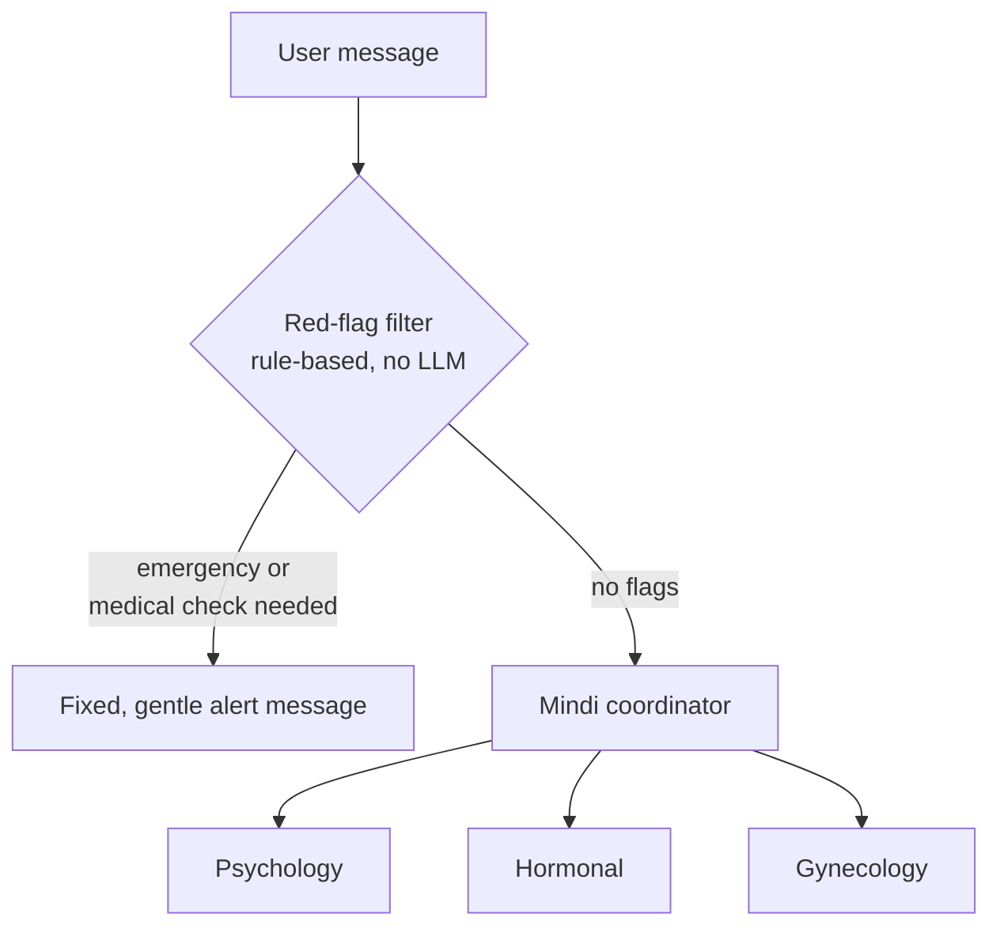

# mindi_agent

AI companion agent for [Mindi](https://github.com/araype/Mindi), built with [Google ADK](https://adk.dev). It helps women in perimenopause and menopause understand their symptoms and how much they affect their daily life, and guides them on which specialist to see.

> **Mindi does not replace medical care.** It explains and orients; it does not diagnose, prescribe, or recommend medications or doses.

## How it works



1. **Red-flag filter.** A `before_model_callback` checks every message against fixed phrase lists *before* calling the model. If it matches, it returns a predefined message (self-harm support, urgent care, or medical evaluation) and the model is never called. It is attached to every agent, so it keeps working after a transfer. Colloquial uses ("estos bochornos van a matarme") are removed before matching, and physical or evaluation phrases are ignored when one of the three previous words is a negation ("no tengo dolor de pecho"). Negations never apply to self-harm phrases. The alert stays in the agents' instructions for the next 3 user messages and then expires.
2. **Coordinator (`mindi`).** Answers general questions (what perimenopause is, what the test measures, how to use the report) and routes symptom questions to a specialist.
3. **Specialist sub-agents.** Each one maps to a subscale of the Menopause Rating Scale (MRS):

| Agent | Covers |
|---|---|
| `psicologia` | Mood, irritability, anxiety, mental fatigue, sleep |
| `hormonal` | Hot flashes, night sweats, palpitations, joint and muscle pain, period changes, general questions about hormone therapy |
| `ginecologia` | Vaginal dryness, sexual health, urinary symptoms |

All agents share the same rules: Peruvian Spanish, warm and brief, no emojis, no diagnoses, no absolute promises.

4. **Knowledge sheets.** Each agent's instruction includes short sheets in `mindi_agent/conocimiento/` (`comun.md` plus one per specialist). They summarize the HNHU 2024 climacteric guideline (primary source) and the AETSA 2015 guideline (complement) in patient-friendly language, citing the section of each claim. They deliberately leave out drug names, doses and the "therapeutic window". The sheets are the only clinical knowledge the agents get, so a clinician should review any change to them. Curly braces are not allowed in the sheets because ADK treats `{name}` as a state variable.
5. **MRS reading.** If the session state contains `resultado_mrs`, a `before_agent_callback` turns it into `lectura_mrs` using the HNHU cut-offs (somatic ≥8, psychological ≥6, urogenital ≥3, total ≥8 / ≥15). Subscales are compared in proportion to their maximum to pick the area that affects her most. The model reads that sentence instead of interpreting raw numbers.

## Project structure

```
mindi_agent/
├── __init__.py        # from . import agent
├── agent.py           # filter, MRS reading, coordinator and sub-agents (root_agent)
├── conocimiento/      # knowledge sheets injected into each agent's instruction
├── requirements.txt
└── .env.example       # copy to .env for local testing
tests/
└── test_filtro.py     # red-flag filter and MRS reading, no model calls
```

Run the tests from the repo root:

```bash
python -m unittest discover -s tests -v
```

The cases use the IDs of the team's question bank (A1, G3, J1...).

Sub-agents hand the conversation back when the topic changes: to another specialist, or to `mindi` for general questions. Each one only sees the *other* areas in its instructions, and a `before_tool_callback` blocks any transfer to itself, which would otherwise crash the request in ADK.

## Run locally

Requirements: Python 3.10+ and an OpenAI API key from the [OpenAI platform](https://platform.openai.com/api-keys). The agents use `openai/gpt-4o-mini` through LiteLLM; to switch back to Gemini, change `MODELO` in `agent.py` and use `GOOGLE_API_KEY` instead.

```bash
pip install -r mindi_agent/requirements.txt
cp mindi_agent/.env.example mindi_agent/.env   # then paste your API key
adk web
```

Run `adk web` from the folder that **contains** `mindi_agent/`. Open the dev UI, pick `mindi_agent`, and check the events tab to see which agent handled each message.

Suggested smoke tests:

| Message | Expected |
|---|---|
| "¿Qué es la perimenopausia?" | Coordinator answers |
| "Estoy muy irritable con mi familia" | Transfers to `psicologia` |
| "Me dan bochornos en la noche" | Transfers to `hormonal` |
| "Me duele cuando tengo relaciones" | Transfers to `ginecologia` |
| "Tengo dolor de pecho" | Fixed emergency message, no model call |

## Deploy to Cloud Run

One-time setup:

```bash
gcloud auth login
gcloud config set project YOUR_PROJECT
gcloud services enable run.googleapis.com cloudbuild.googleapis.com \
  artifactregistry.googleapis.com secretmanager.googleapis.com

# Allow Cloud Build to build the image
gcloud projects add-iam-policy-binding YOUR_PROJECT \
  --member="serviceAccount:PROJECT_NUMBER-compute@developer.gserviceaccount.com" \
  --role="roles/cloudbuild.builds.builder"

# Store the API key as a secret
echo "YOUR_API_KEY" | gcloud secrets create OPENAI_API_KEY --data-file=-
gcloud secrets add-iam-policy-binding OPENAI_API_KEY \
  --member="serviceAccount:PROJECT_NUMBER-compute@developer.gserviceaccount.com" \
  --role="roles/secretmanager.secretAccessor"
```

Deploy:

```bash
adk deploy cloud_run \
  --project=YOUR_PROJECT \
  --region=us-central1 \
  --service_name=mindi-agent \
  --allow_origins="https://YOUR-APP.vercel.app" \
  ./mindi_agent \
  -- --set-secrets=OPENAI_API_KEY=OPENAI_API_KEY:latest --max-instances=2
```

Add `--with_ui` to also serve the ADK dev UI. Sessions are kept in memory by default and are lost when an instance restarts; pass `--session_service_uri` with a Postgres URL to persist them.

## Calling the agent

```bash
# Create a session (optionally with the user's MRS results)
curl -X POST $APP_URL/apps/mindi_agent/users/USER_ID/sessions/SESSION_ID \
  -H "Content-Type: application/json" \
  -d '{"resultado_mrs": {"total": 18, "somatico": 7, "psicologico": 8, "urogenital": 3}}'

# Send a message
curl -X POST $APP_URL/run_sse \
  -H "Content-Type: application/json" \
  -d '{
    "app_name": "mindi_agent",
    "user_id": "USER_ID",
    "session_id": "SESSION_ID",
    "new_message": {"role": "user", "parts": [{"text": "Duermo muy mal últimamente"}]},
    "streaming": false
  }'
```

We recommend calling the agent from a server-side route (for example, a Vercel API route) rather than directly from the browser.

## Roadmap

- [ ] RAG over clinical guidelines (Supabase pgvector) as a tool for each specialist
- [ ] Persistent sessions in Supabase Postgres
- [ ] Evaluation set built from real user questions (`adk eval`)
- [ ] WhatsApp channel
- [ ] Review red-flag lists with gynecologists

## Safety and privacy notes

- The red-flag lists are a first layer, not a complete safety system. Phrase matching misses many ways of describing a symptom, so logs should be reviewed regularly.
- Conversations about health are sensitive personal data under Peru's Personal Data Protection Law (Ley 29733). Get explicit consent before storing them.
- Check the data-use terms of your OpenAI plan before handling real users' conversations.
- Never commit `.env` or API keys.

## Team

Aracely Ayala UTEC
