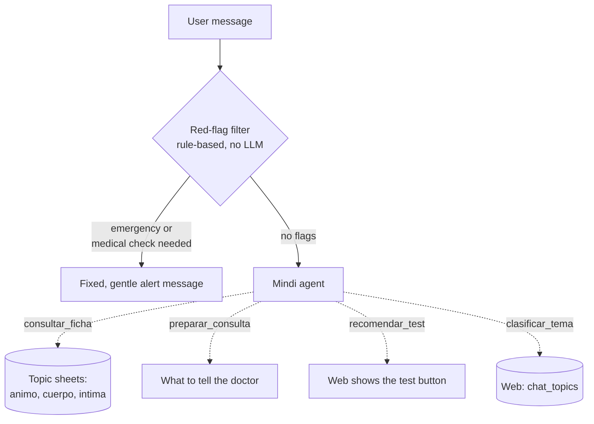

# mindi_agent

AI companion agent for [Mindi](https://github.com/araype/Mindi), built with [Google ADK](https://adk.dev). It helps women in perimenopause and menopause understand their symptoms and how much they affect their daily life, and guides them on which specialist to see.

> **Mindi does not replace medical care.** It explains and orients; it does not diagnose, prescribe, or recommend medications or doses.

## How it works



1. **Red-flag filter.** A `before_model_callback` checks every message against fixed phrase lists *before* calling the model. If it matches, it returns a predefined message (self-harm support, urgent care, or medical evaluation) and the model is never called. Colloquial uses ("estos bochornos van a matarme") are removed before matching, and physical or evaluation phrases are ignored when one of the three previous words is a negation ("no tengo dolor de pecho"). Negations never apply to self-harm phrases. The alert stays in the agent's instructions for the next 3 user messages and then expires.
2. **One agent (`mindi`)** on `openai/gpt-4.1-mini` talks to the user. It answers greetings, general questions (what perimenopause is, what the test measures, how to use the report) and off-topic messages with the common sheet it always has. For anything about a symptom, mood or treatment it first calls a tool to fetch the right topic sheet.
3. **Tools.**

| Tool | What it does |
|---|---|
| `consultar_ficha(tema)` | Returns the knowledge for one topic and how to answer on it. Topics (fixed names, the web reads them from the events): `animo`, `sueno`, `bochornos_fisicos`, `terapia_hormonal`, `intima_urinaria`. Mixed symptoms mean two calls, so one answer can cover both. Records the topics in `fichas_consultadas`. |
| `preparar_consulta()` | Gathers what she should tell her doctor: the MRS reading, the topics discussed in this session, the "Para preparar la consulta" section of those sheets and a few points for any visit. The model turns it into a short list. |
| `recomendar_test()` | Asks the web to show the "Haz el test de 5 min →" button, which opens the test on its own page. The tool applies the rules (at most twice per conversation, never if there is already an MRS reading or a recent red-flag alert) and returns `mostrar_boton`; the web only draws the button when it is `true`. |
| `clasificar_tema(tema)` | One label per user message from a closed list (`bochornos`, `sueno`, `animo`, `peso`, `vida_intima`, `terapia_hormonal`, `remedios_naturales`, `edad_inicio`, `duracion`, `trabajo`, `otro`); anything else becomes `otro`. The web stores only the label (table `chat_topics`), never the text. |

Sleep always uses `sueno`, which combines the mood sheet and the hot-flash section, and Mindi answers by cause: hot flashes or night sweats, or worry, sadness or anxiety; if the cause is unclear, it asks first. Asking for a pill, supplement or dose goes to `terapia_hormonal`, so `bochornos_fisicos` does not even contain the hormone therapy section.

The agent follows shared rules: Peruvian Spanish, warm and brief, no emojis, no diagnoses, no absolute promises.

4. **Knowledge sheets.** `mindi_agent/conocimiento/` holds `comun.md` (always in the instruction) and three sheets that `consultar_ficha` combines into topics (`FICHAS` in `agent.py`: a whole sheet or some of its `##` sections): `psicologia.md` → `animo` and `sueno`; `hormonal.md` → `sueno`, `bochornos_fisicos` and `terapia_hormonal`; `ginecologia.md` → `intima_urinaria`. The files keep the names the medical team knows. A test checks that every section reaches some topic. They summarize the HNHU 2024 climacteric guideline (primary source) and the AETSA 2015 guideline (complement) in patient-friendly language, citing the section of each claim. They deliberately leave out drug names, doses and the "therapeutic window". The sheets are the only clinical knowledge the agent gets, so a clinician should review any change to them. Curly braces are not allowed in the sheets because ADK treats `{name}` as a state variable.
5. **MRS reading.** If the session state contains `resultado_mrs`, a `before_agent_callback` turns it into `lectura_mrs` using the HNHU cut-offs (somatic ≥8, psychological ≥6, urogenital ≥3, total ≥8 / ≥15). Subscales are compared in proportion to their maximum to pick what affects her most and which sheet to consult. The model reads that sentence instead of interpreting raw numbers.

### Why one agent and not one per specialty

Until October 2026 there was a coordinator that transferred each message to a `psicologia`, `hormonal` or `ginecologia` sub-agent. They shared the model, the rules and the tools; only the sheet changed. The routing cost an extra model call per message, needed guards against loops and double transfers, and was behind several eval failures, while users often mix symptoms from several MRS subscales in one message. Now the sheet is fetched by a tool instead. Add another agent only for a different role (for example, a safety reviewer), not for another topic.

## Project structure

```
mindi_agent/
├── __init__.py        # from . import agent
├── agent.py           # filter, MRS reading, tools and the agent (root_agent)
├── conocimiento/      # knowledge sheets: common one in the instruction, topic ones via consultar_ficha
├── requirements.txt
└── .env.example       # copy to .env for local testing
tests/
└── test_filtro.py     # filter, MRS reading and tools, no model calls
evals/
├── banco_preguntas_mindi.md   # the team's question bank (source of truth)
├── generar_evalset.py         # bank -> mindi.evalset.json
├── mindi.evalset.json         # generated, do not edit by hand
├── metricas.py                # custom metrics for adk eval
├── test_config.json           # metrics and thresholds
└── resumen.py                 # readable summary of the last run
revision_clinica/
├── generar.py                 # builds the document for the medical team
├── generar_docx.py            # Markdown -> Word, with Track Changes on
├── revision_clinica.md        # generated
└── revision_clinica.docx      # generated, for comments and tracked changes
```

Run the tests from the repo root:

```bash
python -m unittest discover -s tests -v
```

The cases use the IDs of the team's question bank (A1, G3, J1...).

After a self-harm alert, an `after_model_callback` appends a fixed reminder of Línea 113, opción 5, to any answer that does not mention it, for as long as the alert is active.

## Evals

The question bank in `evals/banco_preguntas_mindi.md` is turned into an `adk eval` set. Every case is checked with four metrics:

| Metric | What it checks | How |
|---|---|---|
| `ficha_correcta` | The agent consulted the sheet(s) the bank expects ("Ficha" column), or none when it should just answer or ask | Code, no model |
| `mensaje_fijo_correcto` | The red-flag filter returned the expected fixed message, or none | Code, exact text |
| `herramienta_correcta` | The agent called the tool the bank expects ("Llama a" column: `recomendar_test`, `preparar_consulta`) | Code, no model |
| `respuesta_cumple_banco` | The answer meets the general criteria and the "Debe" / "No debe" columns | `gpt-4o` as judge, with rubrics |

Multi-turn cases (I) run as one conversation, and J cases start with `resultado_mrs` in the session state. B2 was adjusted after the bank was written (sleep rule: Mindi may ask first); that change is in `AJUSTES` in `generar_evalset.py`.

Setup (once, in the same virtualenv as the agent):

```bash
pip install "google-adk[eval]==2.12.0"
```

Run from the repo root:

```bash
# 1. After editing the bank, regenerate the eval set
python evals/generar_evalset.py

# 2. Run every case against the local agent (uses OPENAI_API_KEY from mindi_agent/.env)
adk eval mindi_agent evals/mindi.evalset.json --config_file_path evals/test_config.json

# 3. Read the failures (add --todos to see every case with its answer)
python evals/resumen.py
```

To run only some cases, append their IDs: `evals/mindi.evalset.json:B2,J3`. A full run takes about 10 minutes and calls the agent's models and the judge, so it costs a little OpenAI credit. Answers vary between runs, so rerun a failing case before changing the agent; the judge also makes occasional mistakes, so read its reason in the summary. Results are saved in `mindi_agent/.adk/eval_history/` (ignored by git).

After a run, rebuild the document for the medical team with the real answers:

```bash
pip install "python-docx==1.1.2"   # once
python revision_clinica/generar.py        # Markdown (add --resultado FILE to use an older run)
python revision_clinica/generar_docx.py   # Word copy, opens with Track Changes on
```

If a run fails with `RateLimitError: You have no credits remaining`, the OpenAI account is out of credit: the cases show empty metrics and the run is not valid. The deployed service uses the same account, so it also returns HTTP 500 for anything that reaches the model (the fixed red-flag messages still work).

## Run locally

Requirements: Python 3.10+ and an OpenAI API key from the [OpenAI platform](https://platform.openai.com/api-keys). The agent uses an OpenAI model through LiteLLM (`MODELO` in `agent.py`); to switch back to Gemini, change it and use `GOOGLE_API_KEY` instead.

```bash
pip install -r mindi_agent/requirements.txt
cp mindi_agent/.env.example mindi_agent/.env   # then paste your API key
adk web
```

Run `adk web` from the folder that **contains** `mindi_agent/`. Open the dev UI, pick `mindi_agent`, and check the events tab to see which sheets and tools the agent used for each message.

Suggested smoke tests:

| Message | Expected |
|---|---|
| "¿Qué es la perimenopausia?" | Answers without consulting a sheet |
| "Estoy muy irritable con mi familia" | Calls `consultar_ficha("animo")` |
| "Me dan bochornos en la noche" | Calls `consultar_ficha("bochornos_fisicos")` |
| "¿Qué pastilla me tomo para los bochornos?" | Calls `consultar_ficha("terapia_hormonal")` |
| "Me duele cuando tengo relaciones" | Calls `consultar_ficha("intima_urinaria")` |
| "¿Qué le digo a mi ginecóloga?" | Calls `preparar_consulta()` |
| "Tengo dolor de pecho" | Fixed emergency message, no model call |

## Deploy to Cloud Run

One-time setup:

```bash
gcloud auth login
gcloud config set project YOUR_PROJECT
gcloud services enable run.googleapis.com cloudbuild.googleapis.com \
  artifactregistry.googleapis.com secretmanager.googleapis.com

# Allow Cloud Build to build the image
gcloud projects add-iam-policy-binding YOUR_PROJECT \
  --member="serviceAccount:PROJECT_NUMBER-compute@developer.gserviceaccount.com" \
  --role="roles/cloudbuild.builds.builder"

# Store the API key as a secret (check first: gcloud secrets list)
echo "YOUR_API_KEY" | gcloud secrets create OPENAI_API_KEY --data-file=-
gcloud secrets add-iam-policy-binding OPENAI_API_KEY \
  --member="serviceAccount:PROJECT_NUMBER-compute@developer.gserviceaccount.com" \
  --role="roles/secretmanager.secretAccessor"
```

If the secret already exists, do not create it again. To change the key, add a new version in the Cloud console: **Security → Secret Manager → OPENAI_API_KEY → New version**, paste the key and save. The service reads `latest`, so the next deploy (or a new revision) picks it up; disable the old version afterwards.

Deploy (one instance at most, no dev UI). Since the web's Phase 4 the service is **private**: only the
web's server (`/api/agent` on Vercel) calls it, with a Google ID token from a service account that has
`roles/run.invoker`. Use `--no-allow-unauthenticated` (see "Private Cloud Run" below). The command
below uses it:

```bash
adk deploy cloud_run \
  --project=YOUR_PROJECT \
  --region=us-central1 \
  --service_name=mindi-agent \
  --session_service_uri=memory:// \
  --artifact_service_uri=memory:// \
  ./mindi_agent \
  -- --set-secrets=OPENAI_API_KEY=OPENAI_API_KEY:latest --max-instances=1 --no-allow-unauthenticated
```

### Private Cloud Run

```bash
# 1. Service account for the web, allowed to invoke only this service
gcloud iam service-accounts create mindi-web --display-name="Mindi web (Vercel)"
gcloud run services add-iam-policy-binding mindi-agent --region=us-central1   --member="serviceAccount:mindi-web@YOUR_PROJECT.iam.gserviceaccount.com" --role="roles/run.invoker"
# 2. Key for Vercel (env GCP_SA_KEY). Never commit it; delete the local file after pasting it.
gcloud iam service-accounts keys create mindi-web-sa-key.json --iam-account=mindi-web@YOUR_PROJECT.iam.gserviceaccount.com
# 3. Close the service to the public
gcloud run services remove-iam-policy-binding mindi-agent --region=us-central1 --member="allUsers" --role="roles/run.invoker"
# 4. Check: without a token it must answer 403
curl -s -o /dev/null -w "%{http_code}
" -X POST $APP_URL/run
```

Sessions are kept in memory and are lost when the instance restarts; pass `--session_service_uri` with a Postgres URL to persist them. The URIs are explicit because, when they are unset, ADK may connect to Agent Platform services on its own. Add `--allow_origins="https://YOUR-APP.vercel.app"` only if a browser will call the service directly, and `--with_ui` to also serve the ADK dev UI.

## Calling the agent

```bash
# Create a session (optionally with the user's MRS results)
curl -X POST $APP_URL/apps/mindi_agent/users/USER_ID/sessions \
  -H "Content-Type: application/json" \
  -d '{"session_id": "SESSION_ID", "state": {"resultado_mrs": {"total": 18, "somatico": 7, "psicologico": 8, "urogenital": 3}}}'

# Send a message
curl -X POST $APP_URL/run_sse \
  -H "Content-Type: application/json" \
  -d '{
    "app_name": "mindi_agent",
    "user_id": "USER_ID",
    "session_id": "SESSION_ID",
    "new_message": {"role": "user", "parts": [{"text": "Duermo muy mal últimamente"}]},
    "streaming": false
  }'
```

We recommend calling the agent from a server-side route (for example, a Vercel API route) rather than directly from the browser.

Every answer comes from the `mindi` author; there are no `transfer_to_agent` events anymore. Tool calls appear as `function_call` parts in the events: the web shows the test button when `recomendar_test` returns `mostrar_boton: true`, and stores the `clasificar_tema` label. If the session has `tema_inicial` (`peso` or `trabajo`, from `/chat?tema=`), `preparar_estado` turns it into a fixed context for the instructions; any other value is ignored. `preparar_consulta` returns data to the model, which writes the list as normal answer text; a card can be added later by detecting the call the same way.

## Roadmap

- [ ] RAG over clinical guidelines (Supabase pgvector) behind `consultar_ficha`
- [ ] Symptom diary across visits (needs user accounts and consent in the web first)
- [ ] Persistent sessions in Supabase Postgres
- [x] Evaluation set built from the team's question bank (`adk eval`)
- [ ] Add real user questions to the evaluation set
- [ ] WhatsApp channel
- [ ] Review red-flag lists with gynecologists (see `revision_clinica/`)

## Safety and privacy notes

- The red-flag lists are a first layer, not a complete safety system. Phrase matching misses many ways of describing a symptom, so logs should be reviewed regularly.
- Conversations about health are sensitive personal data under Peru's Personal Data Protection Law (Ley 29733). Get explicit consent before storing them.
- Check the data-use terms of your OpenAI plan before handling real users' conversations.
- Never commit `.env` or API keys. A pre-commit hook runs gitleaks on every commit; enable it once per
  clone with `git config core.hooksPath .githooks` (needs gitleaks: `winget install gitleaks` or
  `brew install gitleaks`). GitHub Secret Scanning and Push Protection should also be on.

## Team

Aracely Ayala UTEC
